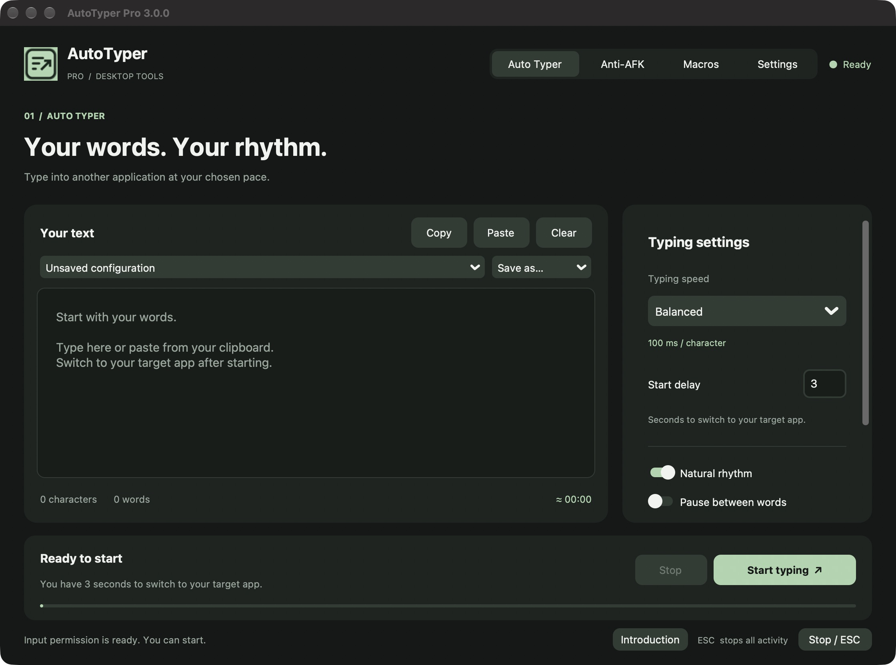
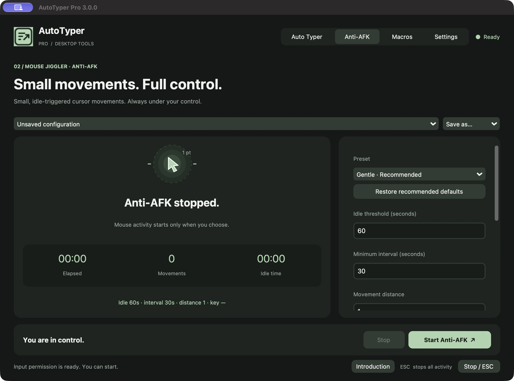
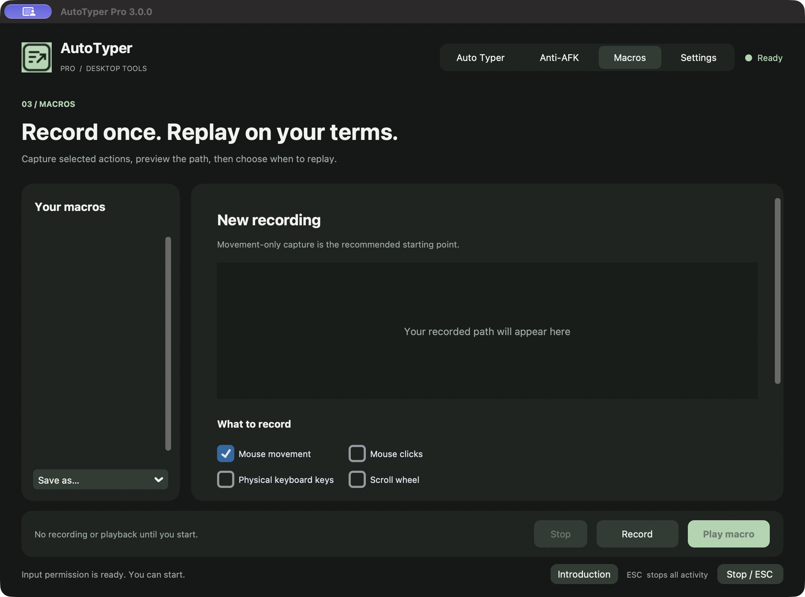

<p align="center"></p>
<h1 align="center">AutoTyper Pro</h1>
<p align="center"><strong>Less repetition. Your pace. Your control.</strong><br>Automatic typing, Mouse Jiggler / Anti-AFK and local macros for macOS and Windows.</p>
<p align="center"><a href="https://github.com/AetheriusCo/AutoTyperPro/releases/latest">Download</a> · <a href="docs/INSTALLATION.md">Installation & permissions</a> · <a href="CONTRIBUTING.md">Contribute</a> · <a href="README_TR.md">Türkçe</a></p>


AutoTyper Pro is a local desktop utility for repetitive typing and small, idle-triggered mouse movements. Paste your text, choose a rhythm, and switch to the target application during the countdown. Start Mouse Jiggler independently when you need it. Record selected actions as local macros when you need repeatable sequences. **Escape stops all activity.**

No account. No telemetry. No automatic activity on launch.

Created by [Hamit Can Fındık](https://github.com/hamitcf1) · [AetheriusCo](https://github.com/AetheriusCo).

## Download

| Platform | Recommended download | Alternative |
| --- | --- | --- |
| macOS — Apple Silicon | [Drag-to-install DMG](https://github.com/AetheriusCo/AutoTyperPro/releases/download/v3.0.1/AutoTyperPro-3.0.1-macos-arm64.dmg) | M-series Macs |
| macOS — Intel | [Drag-to-install DMG](https://github.com/AetheriusCo/AutoTyperPro/releases/download/v3.0.1/AutoTyperPro-3.0.1-macos-x64.dmg) | Intel Macs |
| Windows — x64 | [Setup installer](https://github.com/AetheriusCo/AutoTyperPro/releases/download/v3.0.0/AutoTyperPro-3.0.0-windows-x64-setup.exe) | [Portable ZIP](https://github.com/AetheriusCo/AutoTyperPro/releases/download/v3.0.0/AutoTyperPro-3.0.0-windows-x64-portable.zip) |

[All releases, SHA-256 checksums and build verification](https://github.com/AetheriusCo/AutoTyperPro/releases/latest)

**macOS: 3.0.1 · Windows: 3.0.0.** The macOS hotfix corrects typing through Screen Sharing. Saved profiles, customizable desktop tools and local macro recording are available on both platforms. Each release includes build verification and SHA-256 checksums.

Packages are not Developer ID notarized or Windows Authenticode signed. See the [installation guide](docs/INSTALLATION.md) before opening them.

## Features

| Auto Typer | Mouse Jiggler / Anti-AFK |
| --- | --- |
| Six speed modes, including a custom random range | Independent start and stop controls |
| Start delay from 0 to 60 seconds | Recommended presets plus adjustable idle threshold and interval |
| Natural timing variation and word pauses | Adjustable distance, horizontal/vertical return or a small square |
| Newlines as spaces, Shift+Enter or skipped | F13–F20 or a custom physical key/shortcut; keyboard activity off by default |
| Unicode typing, live progress and time estimate | Automatically waits while Auto Typer runs |
| Optional sound notifications | Avoids restoring the cursor over a user's mouse movement |

Save, rename, duplicate and import/export typing and Anti-AFK profiles as JSON. Restore the clearly marked recommended defaults whenever you want.

**Macros:** record mouse movement, clicks, physical keys and scrolling independently. Preview the path, save named recordings, then replay at 0.25–4× speed with a start delay, repeat count and pause between repeats. Movement-only capture is selected initially. Recordings stay local and are limited to five minutes / 10,000 events. Keyboard recordings are platform-specific and depend on the current keyboard layout.

**Settings:** language, dark/light/system appearance and sound preferences. Language changes preserve your editor text and configuration.

**Screen Sharing on macOS:** automatic physical-key delivery fixes repeated A characters on a remote Mac. Use matching keyboard layouts on both computers. Unsupported remote characters are rejected before typing starts; local Unicode remains supported. See [remote typing setup](docs/INSTALLATION.md#typing-through-macos-screen-sharing).

Mouse Jiggler does not click. It does not guarantee that a particular service will show you as online or that the operating system will stay awake.

## A look inside

A look at the 3.0 interface:



<details><summary>Mouse Jiggler / Anti-AFK and macros</summary>





</details>

## Quick start

1. Download the package matching your platform.
2. **Mac:** open the DMG, drag AutoTyperPro into Applications, eject the image, then open the installed app. **Windows:** run Setup, or extract the entire portable ZIP before launching.
3. On macOS, grant the installed app keyboard/mouse control access when requested. See [permissions troubleshooting](docs/INSTALLATION.md#macos-permissions).
4. Paste text, choose your settings and start typing. Switch to your target app during the countdown.
5. Use the separate Mouse Jiggler tab for idle-triggered activity. Press **Escape** to stop.

A short, skippable introduction appears on first launch and can be replayed from the application.

## Privacy and control

Text and input activity stay on your device. The application does not send them to a server. Typing and mouse activity start only when you choose to start them and stop when the application closes. The permission restart action uses a temporary local file to restore your current text/settings and deletes its owned file after restoration.

## Run from source

Requires Python 3.11+ with Tk support. Packaged downloads include their runtime; Python is only needed for source development.

```bash
git clone https://github.com/AetheriusCo/AutoTyperPro.git
cd AutoTyperPro
python -m venv .venv
```

**macOS:** `./run_mac.command` installs dependencies and launches the app. **Windows:** run the following in PowerShell:

```powershell
.venv\Scripts\python -m pip install -r requirements.txt
.venv\Scripts\python auto_typer.py
```

Source execution may require permission for Python or the launching terminal rather than the packaged application.

## Development

See [Contributing](CONTRIBUTING.md) for tests, native input verification and build commands. Build sources for the macOS DMG and Windows installer are kept in `packaging/`; generated binaries and virtual environments are excluded from Git.

Found a problem? [Report a bug](https://github.com/AetheriusCo/AutoTyperPro/issues/new?template=bug_report.yml) with the application version, OS, installation method and reproduction steps. Please remove private text and identifying details from logs or screenshots.
